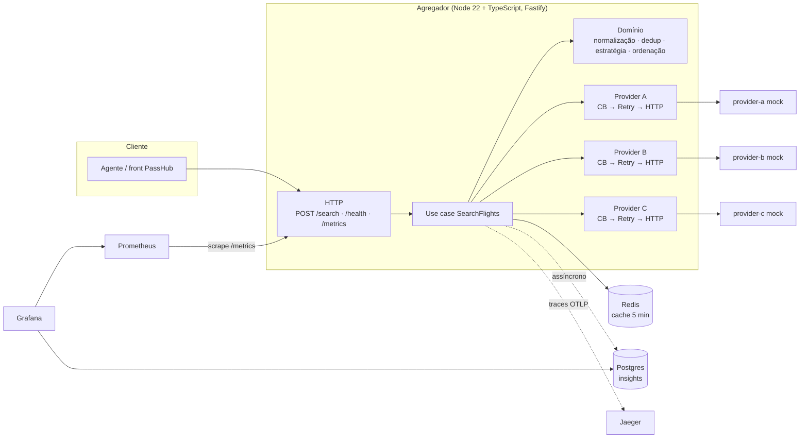
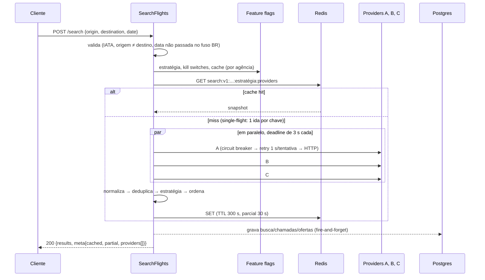
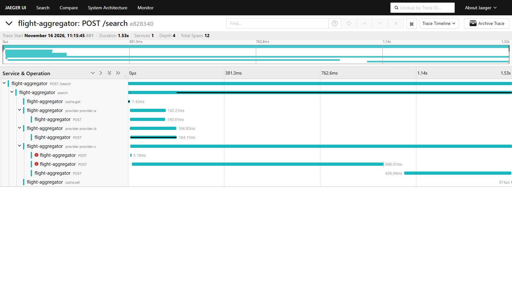
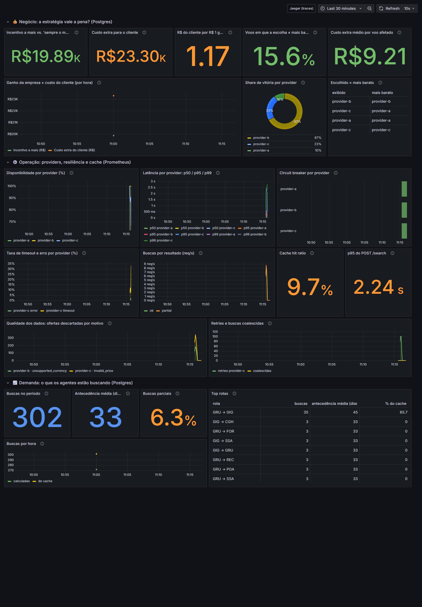

# Agregador de Voos: Desafio PassHub (Parte 1)

API que consulta três provedores de passagens **em paralelo**, normaliza contratos diferentes,
**deduplica** o mesmo voo e escolhe qual oferta exibir com uma **estratégia que equilibra o
incentivo da empresa e o preço para o cliente**. Tem resiliência (timeout, retry, circuit
breaker), cache Redis, observabilidade completa e persistência analítica com dashboard.

```bash
make up        # providers + redis + postgres + agregador (porta 8000)
make search    # busca de exemplo (data = hoje + 30 dias)
make health    # estado de todos os componentes
```

> Só precisa de Docker. Nenhum `.env` é obrigatório para subir a stack.
> Para observabilidade (Jaeger, Prometheus e Grafana): `make obs`.
> Configuração completa (serviços, portas, variáveis, flags, CI/CD): **[docs/CONFIGURACAO.md](docs/CONFIGURACAO.md)**.

---

## Sumário

1. [Checklist do desafio → evidência](#1-checklist-do-desafio--evidência)
2. [Arquitetura](#2-arquitetura)
3. [Decisões e trade-offs](#3-decisões-e-trade-offs)
4. [Regra de negócio: estratégia de seleção](#4-regra-de-negócio-estratégia-de-seleção)
5. [Resiliência](#5-resiliência)
6. [Cache](#6-cache)
7. [Observabilidade](#7-observabilidade)
8. [Testes](#8-testes)
9. [Feature flags](#9-feature-flags)
10. [Deploy](#10-deploy)
11. [Limitações e próximos passos em produção](#11-limitações-e-próximos-passos-em-produção)
12. [Ajustes no ambiente fornecido](#12-ajustes-no-ambiente-fornecido)

---

## 1. Checklist do desafio → evidência

### Requisitos obrigatórios

| Requisito | Onde está | Como foi verificado |
|---|---|---|
| `POST /search` (origem, destino, data) | `aggregator/src/interfaces/http/routes/search.route.ts` | e2e + testes de rota |
| Consultas **paralelas** | `application/search-flights.ts` (`Promise.allSettled`) | teste "calls the providers in parallel" (3 × 80 ms < 200 ms) |
| **Timeout de 3 s** por provider | `application/deadline.ts` + `AbortSignal` no `fetch` | teste com servidor HTTP real: o socket é **cancelado** (servidor vê a conexão fechar) |
| Responde mesmo com falha de provider | `search-flights.ts` (`partial: true`, 503 só se **todos** falharem) | testes de degradação + carga sob chaos (100% HTTP 200) |
| Cache Redis, **TTL 5 min** | `infrastructure/cache/redis-search-cache.ts` | Testcontainers (Redis real): TTL, miss, corrupção, Redis fora/pendurado |
| Normalização para modelo único | `domain/flight-offer.ts` + `infrastructure/providers/mappers/` | testes contra **respostas reais** dos mocks (fixtures) |
| **Ordenação consistente** | `domain/sorting.ts` (preço → partida → duração → flightKey) | ordem total testada embaralhando a entrada; e2e compara 2 chamadas |
| README com arquitetura e trade-offs | este arquivo + [11 ADRs](docs/adr) | — |
| Docker Compose | `docker-compose.yml` (mesmo arquivo do desafio) | `make up` em máquina limpa + CI sobe a stack a cada commit |
| Testes automatizados | 262 testes (unit + integração) + 10 e2e | `make test`, `make e2e`, CI |

### Regra de negócio

| Item | Evidência |
|---|---|
| Incentivos A 1%, B 1,5%, C 2% | `domain/provider.ts` (basis points) |
| Estratégia que maximiza o negócio sem prejudicar o cliente | `domain/selection/strategies.ts` (`BalancedStrategy`) · [ADR 0004](docs/adr/0004-estrategia-de-selecao.md) |
| Trade-offs documentados | ADR 0004 + `npm run simulate` (números reais) + painel no Grafana |

### Bônus

| Bônus | Status | Onde |
|---|---|---|
| Retry exponencial | ✅ full jitter, orçamento compartilhado de 3 s | `infrastructure/resilience/retry.ts` · [ADR 0007](docs/adr/0007-resiliencia-retry-circuit-breaker.md) |
| Circuit breaker | ✅ por provider, conta chamada lógica | `infrastructure/resilience/circuit-breaker.ts` |
| OpenTelemetry | ✅ trace por busca → Jaeger | `infrastructure/observability/telemetry.ts` · [ADR 0008](docs/adr/0008-observabilidade.md) |
| Logs estruturados | ✅ pino JSON com `requestId`, `searchId`, `traceId` | `interfaces/http/app.ts` |
| Métricas Prometheus | ✅ `GET /metrics` (operação + negócio) | `infrastructure/observability/metrics.ts` |
| Health check | ✅ `/health`, `/health/live`, `/health/ready` | `interfaces/http/routes/health.route.ts` |
| GitHub Actions | ✅ CI + CD (workflows prontos; rodam no primeiro push) | `.github/workflows/` · [ADR 0011](docs/adr/0011-ci-cd-e-deploy.md) |
| Docker multi-stage | ✅ alpine, não-root, HEALTHCHECK | `aggregator/Dockerfile` |
| Feature flags | ✅ OpenFeature, recarga a quente, por agência | `infrastructure/flags/` · [ADR 0010](docs/adr/0010-feature-flags.md) |
| Deploy em cloud com IP público | ⏳ pipeline e scripts prontos; **aguarda VM e repositório** | [docs/DEPLOY.md](docs/DEPLOY.md) |
| Banco + dashboard de insights | ✅ Postgres + Grafana provisionado | `infrastructure/persistence/` · [ADR 0009](docs/adr/0009-persistencia-e-dashboard.md) |

---

## 2. Arquitetura

### Componentes



### Fluxo de uma busca



### Camadas (hexagonal, direção garantida por lint)

```
aggregator/src/
  domain/           regras puras: Money em centavos, companhia + aliases, chave de voo,
                    estratégias de seleção, ordenação, erros. Zero dependência de framework.
  application/      use case SearchFlights + ports (FlightProvider, SearchCache,
                    SearchRepository, FeatureFlags, SearchObserver, Tracer, Clock).
  infrastructure/   adapters: providers (mappers, HTTP, retry, circuit breaker), Redis,
                    Postgres (Drizzle), Prometheus, OpenTelemetry, OpenFeature.
  interfaces/http/  Fastify: rotas, health, /metrics, Problem Details (único mapa erro→HTTP).
  main.ts           composition root: injeção de dependência manual.
```

O ESLint (`no-restricted-imports`) **impede** o `domain/` de importar infraestrutura ou
framework e o `application/` de importar infraestrutura ([ADR 0002](docs/adr/0002-arquitetura-hexagonal.md)).

---

## 3. Decisões e trade-offs

| # | Decisão | Por quê (resumo) | ADR |
|---|---|---|---|
| 1 | Node 22 + TypeScript (o scaffold sugere Python) | defendo linha a linha; a interface `make` do avaliador ficou igual | [0001](docs/adr/0001-linguagem-node-typescript.md) |
| 2 | Hexagonal com DI manual, Fastify, Zod | regra de negócio testável sem rede; sem a "mágica" de framework | [0002](docs/adr/0002-arquitetura-hexagonal.md) |
| 3 | Modelo canônico só com dados reais; dinheiro em centavos; hora local sem fuso | não inventar número de voo/escala; nunca float para preço | [0003](docs/adr/0003-modelo-canonico-e-normalizacao.md) |
| 4 | Estratégia **Balanced** (banda τ = 1,5% + teto R$ 25) | captura 43% do ganho máximo com 15% do custo para o cliente | [0004](docs/adr/0004-estrategia-de-selecao.md) |
| 5 | `allSettled` + deadline em 2 camadas; **503 só se todos falharem** | "não há voos" ≠ "não consegui perguntar" | [0005](docs/adr/0005-contrato-de-busca-e-paralelismo.md) |
| 6 | Cache da resposta final; parcial por 30 s; single-flight; Redis fora = sem cache | hit barato; resposta degradada não fica congelada | [0006](docs/adr/0006-cache-redis.md) |
| 7 | Retry de 1 s/tentativa dentro de 3 s; breaker conta **chamada lógica** | sob chaos: 89% de sucesso e o circuito nunca abriu | [0007](docs/adr/0007-resiliencia-retry-circuit-breaker.md) |
| 8 | Readiness **não** depende de Redis/Postgres | dependência opcional não pode tirar todas as réplicas do ar | [0008](docs/adr/0008-observabilidade.md) |
| 9 | Persistência fire-and-forget com backpressure | analítico não atrasa nem derruba a busca | [0009](docs/adr/0009-persistencia-e-dashboard.md) |
| 10 | OpenFeature com arquivo recarregado a quente | kill switch e A/B de τ sem deploy | [0010](docs/adr/0010-feature-flags.md) |
| 11 | CI com a stack inteira; CD multi-arch → VM Oracle | o que roda em produção é o que a CI testou | [0011](docs/adr/0011-ci-cd-e-deploy.md) |

Material de defesa (pitch, perguntas e respostas, pontos fracos, mapa do código):
**[docs/DEFESA.md](docs/DEFESA.md)**.

---

## 4. Regra de negócio: estratégia de seleção

**O problema:** o incentivo é um **percentual do preço**. "Maximizar incentivo" sem limite
significa escolher a passagem **mais cara**. A receita real é `P(emissão) × incentivo`, e preço
pior derruba a emissão.

**Como os mocks precificam** (medido, constante): markup A = 1,000 · B = 0,985 · C = 1,012.
B é mais barato **e** rende mais que A (domina). C contra B custa ao cliente 5× o que a empresa
ganha. A única troca discutível é **C contra A**: +1,2% para o cliente, +1,02 p.p. para a
empresa.

**Fórmula (BalancedStrategy):**

```
p_min     = menor preço do voo
elegível  ⇔ preço ≤ p_min × (1 + τ)   e   preço − p_min ≤ teto   [e ganho ≥ k × Δ, se k > 0]
escolha   = maior incentivo entre os elegíveis; desempate: menor preço → menor duração → provider
τ = 1,5%  ·  teto = R$ 25  ·  k = 0   (todos ajustáveis por feature flag)
```

**Exemplo:** voo de base R$ 800 vendido por A (R$ 800,00 → incentivo R$ 8,00) e C (R$ 809,60 →
R$ 16,19). C está na banda (≤ R$ 812) e no teto (Δ R$ 9,60 ≤ R$ 25): **exibe C**. Cada oferta
registra `deltaToCheapestCents: 960` e `incentiveGainVsCheapestCents: 819`.

**Resultado (`make simulate`, mocks reais, 60 voos; mesmas proporções em 900 voos):**

| Estratégia | Incentivo | Custo extra p/ cliente | R$ cliente por R$ 1 (marginal) | Voos ≠ mais barato |
|---|---|---|---|---|
| cheapest | R$ 625,61 | R$ 0,00 | — | 0% |
| **balanced** | **R$ 701,90 (+12,2%)** | **R$ 89,38** | **1,17** | **16,7%** |
| max_incentive | R$ 803,47 (+28,4%) | R$ 591,11 | 4,94 | 58,3% |

A Balanced captura **43%** do ganho máximo com **15%** do custo para o cliente; ir além custa
R$ 4,94 ao cliente por R$ 1 de incentivo. τ = 1,5% fica no meio do platô [1,20%; 2,74%), então a
decisão não é sensível a ruído de preço. Com dados reais (Grafana, 302 buscas), o painel bate com
o simulate: **R$ 1,17 do cliente por R$ 1 ganho**.

---

## 5. Resiliência

| Mecanismo | Configuração | Por quê |
|---|---|---|
| Deadline por provider | **3 s** totais (`AbortSignal` cancela o socket + corrida `withDeadline`) | requisito; bulkhead: um provider nunca segura os outros |
| Retry | até 3 tentativas de **1 s** dentro dos 3 s; backoff exponencial com full jitter; só 5xx/429/408/rede/timeout | o mock pendura 30 s: abandonar em 1 s e tentar de novo recupera a oferta |
| Circuit breaker | janela de 20 chamadas lógicas, mín. 10, abre com ≥ 50%, 10 s aberto, 1 sonda em half-open | provider morto é pulado na hora (`circuit_open`) |
| Degradação | `partial: true` (200); 503 só se todos falharem | resultado útil > erro |

**Medido sob chaos** (`make chaos`: 30% pendurado + 21% de 500, 200 buscas):

| | provider-c ok | circuito aberto | p99 provider-c |
|---|---|---|---|
| com retry | **89%** (teoria: 1 − 0,51³ ≈ 87%) | **nunca** | 3.004 ms |
| sem retry (controle) | 3% | 90% das buscas | — |



*Trace real: provider-c devolve 500 (5 ms), a 2ª tentativa pendura e é abandonada aos ~1.000 ms,
e a 3ª responde em 426 ms. A busca inteira levou 1,53 s, dentro do orçamento.*

---

## 6. Cache

- **O quê:** a resposta **final** (já deduplicada e selecionada), em Redis.
- **Chave:** `search:v1:{ORIG}:{DEST}:{DATA}:{estratégia:τ:teto:k}:{providers ligados}`. Trocar a
  estratégia por flag vale na hora, e um kill switch por agência não vaza pelo cache.
- **TTL:** 5 min (completa) · **30 s (parcial)**, para não congelar uma resposta degradada.
- **Stampede:** single-flight; medido: 20 buscas simultâneas = 1 chamada por provider.
- **Redis fora:** cliente que falha rápido (sem fila offline, 200 ms por comando) e a busca segue
  sem cache. Testado com Redis desligado, pendurado e parado ao vivo.

Detalhes: [ADR 0006](docs/adr/0006-cache-redis.md).

---

## 7. Observabilidade

| Ferramenta | Acesso (`make obs`) | O que mostra |
|---|---|---|
| Grafana | http://localhost:3000 (leitura anônima; admin/admin) | dashboard "Agregador de Voos · Insights" |
| Jaeger | http://localhost:16686 | um trace por busca: provider, tentativas, cache |
| Prometheus | http://localhost:9090 | métricas brutas (`/metrics` do agregador) |
| Logs | `make logs` | JSON com `requestId`, `searchId`, `traceId` |
| Health | `make health` / `/health/live` / `/health/ready` | componentes, circuitos, versão |



*Dashboard com tráfego real (normal + chaos): R$ 1,17 do cliente por R$ 1 ganho; 15,6% dos voos
com escolha ≠ mais barato; share B 67% · C 23% · A 10%; disponibilidade, latência e circuitos
por provider; top rotas e antecedência.*

---

## 8. Testes

```bash
make test   # unit + integração (Redis e Postgres reais via Testcontainers; requer Docker)
make cov    # idem com cobertura (meta ≥ 85% em domain/application)
make up && make e2e   # e2e contra a stack real (mocks do desafio)
make lint   # eslint + prettier + tsc
```

| Nível | Qtd. | O que cobre |
|---|---|---|
| Unit | 238 | estratégias (table-driven), ordenação, dedup, mappers com **respostas reais**, retry, circuit breaker (relógio falso), validação, flags, métricas, tracing, rotas HTTP |
| Integração | 24 | HTTP real (cancelamento de socket), **Redis real**, **Postgres real** (migrations, transação, backpressure), **todas as queries SQL do dashboard** |
| E2E | 10 | stack via compose: 60 voos únicos, sujos descartados, 4 grafias → 4 companhias, D+1, estratégia, cache hit com a mesma ordem, 400, health, metrics |

**Cobertura** (`make cov`): domain **99%** linhas / 98% branches · application **98%** / 93% ·
geral 91%.

Cenários que os mocks não produzem (todos falhando, payload fora do contrato, Redis pendurado,
banco fora) estão nos testes de integração, com dependências simuladas ou derrubadas.

Ferramentas de apoio: `make simulate` (estratégias sobre buscas reais), `make chaos` / `make calm`
e `make load` (200 buscas únicas). Coleção de requisições: [`requests.http`](requests.http).

---

## 9. Feature flags

OpenFeature com provider de arquivo ([`flags/flags.json`](flags/flags.json)), relido a cada 2 s,
**sem restart nem deploy**. O valor pode ser por agência (header `x-agency-id`) e uma variável
de ambiente o sobrescreve (`FLAG_PROVIDER_C_ENABLED=false`).

| Flag | Default | Uso real |
|---|---|---|
| `selection.strategy` | `balanced` | trocar a política (`cheapest` / `max_incentive`) |
| `selection.tolerancePctBps` | `150` | A/B de τ por agência |
| `selection.maxDeltaCents` | `2500` | apertar o teto |
| `selection.minGainRatio` | `0` | exigir ganho ≥ k × custo do cliente |
| `provider.{a,b,c}.enabled` | `true` | **kill switch** em incidente |
| `cache.enabled` | `true` | desligar o cache |

Demonstrado ao vivo: com `provider.c.enabled=false`, a próxima busca veio com `c: disabled`
(55 voos), em ~2 s. [ADR 0010](docs/adr/0010-feature-flags.md).

---

## 10. Deploy

- **Alvo:** VM **Oracle Cloud Always Free** (Ampere A1, ARM), rodando o mesmo `docker-compose.yml`.
- **Pipeline:** push na `main` → CI (qualidade, testes, stack + smoke + e2e) → CD (imagem
  **multi-arch** no GHCR → rsync + SSH → `deploy.sh` → smoke test pelo IP público).
- **Status:** ⏳ scripts e workflows prontos e validados (shellcheck, actionlint, smoke test
  local). **Faltam a VM e o repositório** (passo a passo em [docs/DEPLOY.md](docs/DEPLOY.md)).
- **URL pública:** _a preencher após o primeiro deploy_ — `http://<IP>:8000/search` · Grafana `http://<IP>:3000`.

---

## 11. Limitações e próximos passos em produção

| Tema | Hoje | Evolução |
|---|---|---|
| Acesso | sem autenticação | API key / OAuth por agência + rate limit por agência |
| Moeda | só BRL (USD é descartado) | câmbio com cotação travada no momento da cotação |
| Identidade do voo | companhia + partida (sem número de voo) | número do voo na chave quando o provider enviar |
| Fuso | hora local da origem, sem conversão | tabela IATA → timezone (OurAirports) |
| Cache | single-flight por processo | lock distribuído (`SET NX PX`) ou stale-while-revalidate |
| Persistência | fire-and-forget (pode perder em pico) | outbox / fila (SQS, Kafka) → warehouse |
| Latência com retry | p95 ~2,4 s quando um provider sofre | resposta progressiva (SSE por provider) ou soft deadline |
| Escala | 1 VM | N réplicas atrás de LB, Redis/Postgres gerenciados, autoscaling por p95 |
| Contratos | schemas Zod por provider | contract testing (Pact) com os fornecedores |
| Operação | métricas e dashboards | SLOs (p99 < 3,5 s, parcial < 5%) + alertas |
| Estratégia | τ calibrado no mock | τ calibrado por conversão real; receita esperada `P(emissão|Δ) × incentivo`; A/B por flag |
| Rede | HTTP | TLS (Caddy + Let's Encrypt), WAF |

---

## 12. Ajustes no ambiente fornecido

Nenhum arquivo de `mocks/` foi alterado (`git diff a31f827 -- mocks/` é vazio; o commit `a31f827`
é o scaffold original, intocado). Os ajustes abaixo são de configuração e tooling:

| # | Problema encontrado | Correção |
|---|---|---|
| 1 | `docker-compose.yml` com **YAML inválido**: as linhas `FAIL_RATE`/`TIMEOUT_RATE` do provider-c estavam descomentadas com 7 espaços de indentação, e o `docker compose up` falhava | voltaram a ficar comentadas, que é a intenção do comentário original. O chaos fica desligado por padrão |
| 2 | `make chaos` rodava `docker compose run --service-ports` com o provider-c original ainda ocupando a porta 3003 (conflito) | `docker-compose.chaos.yml` (override) recria o **próprio** `provider-c`; `make calm` desfaz |
| 3 | `make search` usava a data fixa `2026-10-12`, que já passou | data dinâmica (hoje + 30 dias), sobrescrevível com `SEARCH_DATE=` |
| 4 | `mocks/app/__pycache__/*.pyc` vinham no pacote | fora do git pelo `.gitignore`; bytecode conferido como idêntico ao `.py` |
| 5 | Checkout no Windows converte o texto para CRLF, o que quebra Makefile e scripts em containers | `.gitattributes` com `eol=lf` |
| 6 | Alvos `test/cov/lint/fmt` do Makefile chamavam `uv`/`pytest`/`ruff` | mesmos nomes, agora chamando npm ([ADR 0001](docs/adr/0001-linguagem-node-typescript.md)) |

**Taxas reais do chaos:** o mock sorteia o "pendurar" **antes** do 500. Com `0.3/0.3`: ~30%
pendurado, ~21% de 500 e ~49% de sucesso por chamada ([docs/providers.md](docs/providers.md)).
