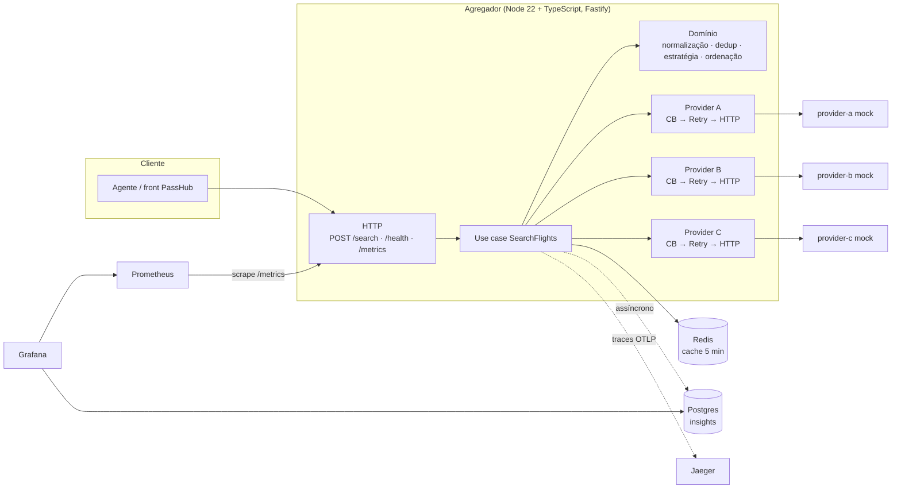
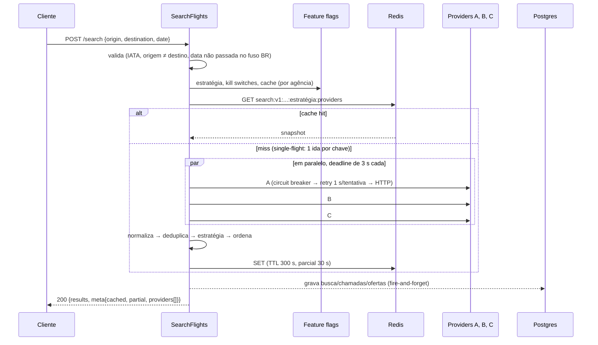

# Agregador de Voos: Desafio PassHub (Parte 1)

API que consulta três provedores de passagens **em paralelo**, normaliza contratos diferentes,
**deduplica** o mesmo voo e escolhe qual oferta exibir com uma **estratégia que equilibra o
incentivo da empresa e o preço para o cliente**. Tem resiliência (timeout, retry, circuit
breaker), cache Redis, observabilidade completa e persistência analítica com dashboard.

```bash
git clone https://github.com/alencastroP/agregador-voos.git
cd agregador-voos
docker compose up -d --build --wait
```

Só precisa de Docker. Nenhum `.env`, Node ou Python é obrigatório. O passo a passo completo está
na [seção 1](#1-como-rodar-localmente).

---

## Sumário

1. [Como rodar localmente](#1-como-rodar-localmente)
2. [Checklist do desafio → evidência](#2-checklist-do-desafio--evidência)
3. [Arquitetura](#3-arquitetura)
4. [Decisões e trade-offs](#4-decisões-e-trade-offs)
5. [Regra de negócio: estratégia de seleção](#5-regra-de-negócio-estratégia-de-seleção)
6. [Resiliência](#6-resiliência)
7. [Cache](#7-cache)
8. [Observabilidade](#8-observabilidade)
9. [Testes](#9-testes)
10. [Feature flags](#10-feature-flags)
11. [Limitações e próximos passos em produção](#11-limitações-e-próximos-passos-em-produção)
12. [Ajustes no ambiente fornecido](#12-ajustes-no-ambiente-fornecido)

---

## 1. Como rodar localmente

### Pré-requisitos

| O quê | Versão / tamanho | Observação |
|---|---|---|
| Docker | Docker Desktop (Windows/macOS) ou Docker Engine (Linux) | com o plugin **Compose v2.20+** (`docker compose version`) |
| Memória livre | ~3 GB | 9 containers: 3 mocks, agregador, Redis, Postgres, Jaeger, Prometheus, Grafana |
| Disco | ~2 GB | imagens baixadas no primeiro `up` |
| Internet | só no primeiro `up` | download das imagens e das dependências do build |

Funciona em Linux, macOS (Intel e Apple Silicon) e Windows (PowerShell, Git Bash ou WSL). Todas as
imagens são multi-arquitetura.

As portas abaixo precisam estar livres. As marcadas com 🔒 só aceitam conexão da própria máquina
(`127.0.0.1`).

| Porta | Serviço | Porta | Serviço |
|---|---|---|---|
| **8000** | agregador (a API) | 16686 🔒 | Jaeger (UI) |
| 3000 | Grafana | 4318 🔒 | Jaeger (OTLP) |
| 3001–3003 | mocks dos providers A, B e C | 9090 🔒 | Prometheus |
| 6379 🔒 | Redis | 5432 🔒 | Postgres |

### Passo a passo

**1. Clonar e subir a stack**

```bash
git clone https://github.com/alencastroP/agregador-voos.git
cd agregador-voos
docker compose up -d --build --wait
```

Na primeira vez leva de 2 a 5 minutos (download das imagens e build do agregador e dos mocks). O
`--wait` só devolve o terminal quando tudo estiver de pé. Para conferir: `docker compose ps` (os 9
serviços rodando; agregador, Redis e Postgres como `healthy`).

**2. Fazer uma busca**

A data precisa ser **futura** (até 365 dias à frente). Datas passadas são rejeitadas com 400.

Linux, macOS, Git Bash ou WSL:

```bash
curl -s -X POST http://localhost:8000/search \
  -H 'Content-Type: application/json' \
  -d '{"origin":"GRU","destination":"GIG","date":"2027-03-15"}'
```

Windows PowerShell:

```powershell
$body = @{ origin = "GRU"; destination = "GIG"; date = (Get-Date).AddDays(30).ToString("yyyy-MM-dd") } | ConvertTo-Json
Invoke-RestMethod -Method Post -Uri http://localhost:8000/search -ContentType "application/json" -Body $body | ConvertTo-Json -Depth 6
```

VS Code (extensão REST Client): abra [`requests.http`](requests.http) e clique em *Send Request*. O
arquivo tem os cenários de sucesso, cache hit, erro de validação, flags por agência e health.

**O que esperar:** `results` com **60 voos** (120 ofertas dos 3 providers, deduplicadas), ordenados
por preço; `meta.cached: false` e os 3 providers `ok`. Repetindo a mesma busca, `meta.cached: true`
e a mesma ordem.

**3. Abrir as ferramentas**

| Endereço | O que é |
|---|---|
| http://localhost:8000/health | estado de cada componente (cache, banco, circuitos, versão) |
| http://localhost:8000/metrics | métricas Prometheus do agregador |
| http://localhost:3000 | Grafana: dashboard "Agregador de Voos · Insights" (leitura sem login; admin: `admin`/`admin`) |
| http://localhost:16686 | Jaeger: um trace por busca (serviço `flight-aggregator`) |
| http://localhost:9090 | Prometheus |

O dashboard começa vazio porque mostra as buscas já feitas. Faça algumas buscas com rotas e datas
diferentes (ou `make load`, que dispara 200) e os painéis se preenchem em poucos segundos.

**4. Parar**

```bash
docker compose down      # para tudo e mantém os dados do Postgres (o dashboard)
docker compose down -v   # para tudo e apaga os dados
```

### Atalhos com `make` (opcional)

Precisam de `make` e de um shell POSIX (Linux, macOS, Git Bash ou WSL). Tudo o que eles fazem
também pode ser feito com os comandos `docker compose` acima.

| Comando | O que faz |
|---|---|
| `make up` | sobe a stack inteira e espera ficar de pé |
| `make search` | busca de exemplo GRU→GIG (hoje + 30 dias). Outra rota: `make search ORIGIN=CGH DEST=SDU` |
| `make health` | estado dos componentes |
| `make logs` | logs JSON do agregador |
| `make chaos` / `make calm` | liga e desliga falhas no provider-c (30% pendurado, ~21% de erro 500) |
| `make stop` / `make down` | para a stack mantendo / apagando os dados |
| `make test` · `make e2e` · `make lint` · `make cov` | testes e qualidade (precisam de Node 22, ver abaixo) |
| `make simulate` · `make load` | comparação das estratégias e carga de 200 buscas (precisam de Node 22) |

### Configuração (opcional)

Nada precisa ser configurado. Para mudar algum default, crie um arquivo `.env` na raiz do
repositório (ele fica fora do git):

| Variável | Default | Para quê |
|---|---|---|
| `POSTGRES_PASSWORD` | `aggregator` | senha do Postgres. Se mudar depois do primeiro `up`, rode `docker compose down -v` |
| `GRAFANA_ADMIN_PASSWORD` | `admin` | senha do admin do Grafana |
| `LOG_LEVEL` | `info` | `debug` mostra cada tentativa de chamada aos providers |
| `OTEL_EXPORTER_OTLP_ENDPOINT` | `http://jaeger:4318` | destino dos traces. Vazio desliga o tracing |

O comportamento de negócio (estratégia, tolerância, kill switch de provider, cache) muda sem
restart em [`flags/flags.json`](flags/flags.json): a alteração vale em cerca de 2 segundos
([seção 10](#10-feature-flags)). Os parâmetros internos do agregador (timeouts, retry, circuit
breaker, TTLs) estão documentados em [`aggregator/.env.example`](aggregator/.env.example).

### Testes e agregador fora do Docker

Precisa de **Node 22** e do Docker rodando (os testes de integração sobem Redis e Postgres reais
com Testcontainers).

```bash
cd aggregator
npm ci
npm test               # 262 testes unitários e de integração
npm run test:e2e       # 10 testes ponta a ponta contra a stack (suba o compose antes)
npm run lint && npm run typecheck
```

Para desenvolver com recarga automática, suba só as dependências e rode o agregador na máquina:

```bash
docker compose up -d --wait provider-a provider-b provider-c redis postgres jaeger
cd aggregator && cp .env.example .env && npm run dev
```

### Problemas comuns

| Sintoma | Causa e solução |
|---|---|
| `port is already allocated` / `address already in use` | outra aplicação usa uma das portas da tabela acima. Pare essa aplicação ou troque o número **da esquerda** no mapeamento `ports` do `docker-compose.yml` (ex.: `"8080:8000"`) |
| `unknown flag: --wait` | Docker Compose antigo. Atualize o Docker ou rode sem `--wait` e acompanhe com `docker compose ps` |
| `Cannot connect to the Docker daemon` | o Docker não está rodando. Abra o Docker Desktop (ou `sudo systemctl start docker`) |
| O build falha baixando dependências (`npm ci` / `pip install`) | o container de build não resolve DNS (comum com VPN ou `systemd-resolved`). Configure um DNS no Docker (`"dns": ["8.8.8.8"]` em Docker Desktop → Settings → Docker Engine, ou em `/etc/docker/daemon.json`) e rode de novo |
| A busca devolve **400** | data passada, mais de 365 dias à frente, IATA inválido ou origem igual ao destino. A resposta lista cada campo com erro |
| `meta.partial: true` | algum provider falhou ou passou de 3 s. É o comportamento esperado (a resposta segue com os outros); veja `meta.providers` |
| Grafana sem dados | ainda não houve buscas. Faça algumas e aguarde ~10 s |
| `make: command not found` no Windows | use os comandos `docker compose` desta seção ou rode o `make` pelo Git Bash/WSL |

---

## 2. Checklist do desafio → evidência

### Requisitos obrigatórios

| Requisito | Onde está | Como foi verificado |
|---|---|---|
| `POST /search` (origem, destino, data) | `aggregator/src/interfaces/http/routes/search.route.ts` | e2e + testes de rota |
| Consultas **paralelas** | `application/search-flights.ts` (`Promise.allSettled`) | teste "calls the providers in parallel" (3 × 80 ms < 200 ms) |
| **Timeout de 3 s** por provider | `application/deadline.ts` + `AbortSignal` no `fetch` | teste com servidor HTTP real: o socket é **cancelado** (servidor vê a conexão fechar) |
| Responde mesmo com falha de provider | `search-flights.ts` (`partial: true`, 503 só se **todos** falharem) | testes de degradação + carga sob chaos (100% HTTP 200) |
| Cache Redis, **TTL 5 min** | `infrastructure/cache/redis-search-cache.ts` | Testcontainers (Redis real): TTL, miss, corrupção, Redis fora/pendurado |
| Normalização para modelo único | `domain/flight-offer.ts` + `infrastructure/providers/mappers/` | testes contra **respostas reais** dos mocks (fixtures) |
| **Ordenação consistente** | `domain/sorting.ts` (preço → partida → duração → flightKey) | ordem total testada embaralhando a entrada; e2e compara 2 chamadas |
| README com arquitetura e trade-offs | este arquivo + [11 ADRs](docs/adr) | — |
| Docker Compose | `docker-compose.yml` (mesmo arquivo do desafio; um comando sobe tudo) | clone limpo + `docker compose up`; a CI sobe a stack a cada commit |
| Testes automatizados | 262 testes (unit + integração) + 10 e2e | `make test`, `make e2e`, CI |

### Regra de negócio

| Item | Evidência |
|---|---|
| Incentivos A 1%, B 1,5%, C 2% | `domain/provider.ts` (basis points) |
| Estratégia que maximiza o negócio sem prejudicar o cliente | `domain/selection/strategies.ts` (`BalancedStrategy`) · [ADR 0004](docs/adr/0004-estrategia-de-selecao.md) |
| Trade-offs documentados | ADR 0004 + `npm run simulate` (números reais) + painel no Grafana |

### Bônus

| Bônus | Status | Onde |
|---|---|---|
| Retry exponencial | ✅ full jitter, orçamento compartilhado de 3 s | `infrastructure/resilience/retry.ts` · [ADR 0007](docs/adr/0007-resiliencia-retry-circuit-breaker.md) |
| Circuit breaker | ✅ por provider, conta chamada lógica | `infrastructure/resilience/circuit-breaker.ts` |
| OpenTelemetry | ✅ trace por busca → Jaeger | `infrastructure/observability/telemetry.ts` · [ADR 0008](docs/adr/0008-observabilidade.md) |
| Logs estruturados | ✅ pino JSON com `requestId`, `searchId`, `traceId` | `interfaces/http/app.ts` |
| Métricas Prometheus | ✅ `GET /metrics` (operação + negócio) | `infrastructure/observability/metrics.ts` |
| Health check | ✅ `/health`, `/health/live`, `/health/ready` | `interfaces/http/routes/health.route.ts` |
| GitHub Actions | ✅ CI: lint, testes, build da imagem, stack inteira + smoke + e2e | `.github/workflows/ci.yml` · [ADR 0011](docs/adr/0011-ci-cd-e-deploy.md) |
| Docker multi-stage | ✅ alpine, não-root, HEALTHCHECK | `aggregator/Dockerfile` |
| Feature flags | ✅ OpenFeature, recarga a quente, por agência | `infrastructure/flags/` · [ADR 0010](docs/adr/0010-feature-flags.md) |
| Deploy em cloud com IP público | ➖ fora do escopo desta entrega: a solução roda localmente com Docker | [ADR 0011](docs/adr/0011-ci-cd-e-deploy.md) (como seria) |
| Banco + dashboard de insights | ✅ Postgres + Grafana provisionado | `infrastructure/persistence/` · [ADR 0009](docs/adr/0009-persistencia-e-dashboard.md) |

---

## 3. Arquitetura

### Componentes



### Fluxo de uma busca



### Camadas (hexagonal, direção garantida por lint)

```
aggregator/src/
  domain/           regras puras: Money em centavos, companhia + aliases, chave de voo,
                    estratégias de seleção, ordenação, erros. Zero dependência de framework.
  application/      use case SearchFlights + ports (FlightProvider, SearchCache,
                    SearchRepository, FeatureFlags, SearchObserver, Tracer, Clock).
  infrastructure/   adapters: providers (mappers, HTTP, retry, circuit breaker), Redis,
                    Postgres (Drizzle), Prometheus, OpenTelemetry, OpenFeature.
  interfaces/http/  Fastify: rotas, health, /metrics, Problem Details (único mapa erro→HTTP).
  main.ts           composition root: injeção de dependência manual.
```

O ESLint (`no-restricted-imports`) **impede** o `domain/` de importar infraestrutura ou
framework e o `application/` de importar infraestrutura ([ADR 0002](docs/adr/0002-arquitetura-hexagonal.md)).

---

## 4. Decisões e trade-offs

| # | Decisão | Por quê (resumo) | ADR |
|---|---|---|---|
| 1 | Node 22 + TypeScript (o scaffold sugere Python) | defendo linha a linha; a interface `make` do avaliador ficou igual | [0001](docs/adr/0001-linguagem-node-typescript.md) |
| 2 | Hexagonal com DI manual, Fastify, Zod | regra de negócio testável sem rede; sem a "mágica" de framework | [0002](docs/adr/0002-arquitetura-hexagonal.md) |
| 3 | Modelo canônico só com dados reais; dinheiro em centavos; hora local sem fuso | não inventar número de voo/escala; nunca float para preço | [0003](docs/adr/0003-modelo-canonico-e-normalizacao.md) |
| 4 | Estratégia **Balanced** (banda τ = 1,5% + teto R$ 25) | captura 43% do ganho máximo com 15% do custo para o cliente | [0004](docs/adr/0004-estrategia-de-selecao.md) |
| 5 | `allSettled` + deadline em 2 camadas; **503 só se todos falharem** | "não há voos" ≠ "não consegui perguntar" | [0005](docs/adr/0005-contrato-de-busca-e-paralelismo.md) |
| 6 | Cache da resposta final; parcial por 30 s; single-flight; Redis fora = sem cache | hit barato; resposta degradada não fica congelada | [0006](docs/adr/0006-cache-redis.md) |
| 7 | Retry de 1 s/tentativa dentro de 3 s; breaker conta **chamada lógica** | sob chaos: 89% de sucesso e o circuito nunca abriu | [0007](docs/adr/0007-resiliencia-retry-circuit-breaker.md) |
| 8 | Readiness **não** depende de Redis/Postgres | dependência opcional não pode tirar todas as réplicas do ar | [0008](docs/adr/0008-observabilidade.md) |
| 9 | Persistência fire-and-forget com backpressure | analítico não atrasa nem derruba a busca | [0009](docs/adr/0009-persistencia-e-dashboard.md) |
| 10 | OpenFeature com arquivo recarregado a quente | kill switch e A/B de τ sem deploy | [0010](docs/adr/0010-feature-flags.md) |
| 11 | CI com a stack inteira a cada commit; deploy fora do escopo | o comando do avaliador (`docker compose up`) é testado em máquina limpa | [0011](docs/adr/0011-ci-cd-e-deploy.md) |

---

## 5. Regra de negócio: estratégia de seleção

**O problema:** o incentivo é um **percentual do preço**. "Maximizar incentivo" sem limite
significa escolher a passagem **mais cara**. A receita real é `P(emissão) × incentivo`, e preço
pior derruba a emissão.

**Como os mocks precificam** (medido, constante): markup A = 1,000 · B = 0,985 · C = 1,012.
B é mais barato **e** rende mais que A (domina). C contra B custa ao cliente 5× o que a empresa
ganha. A única troca discutível é **C contra A**: +1,2% para o cliente, +1,02 p.p. para a
empresa.

**Fórmula (BalancedStrategy):**

```
p_min     = menor preço do voo
elegível  ⇔ preço ≤ p_min × (1 + τ)   e   preço − p_min ≤ teto   [e ganho ≥ k × Δ, se k > 0]
escolha   = maior incentivo entre os elegíveis; desempate: menor preço → menor duração → provider
τ = 1,5%  ·  teto = R$ 25  ·  k = 0   (todos ajustáveis por feature flag)
```

**Exemplo:** voo de base R$ 800 vendido por A (R$ 800,00 → incentivo R$ 8,00) e C (R$ 809,60 →
R$ 16,19). C está na banda (≤ R$ 812) e no teto (Δ R$ 9,60 ≤ R$ 25): **exibe C**. Cada oferta
registra `deltaToCheapestCents: 960` e `incentiveGainVsCheapestCents: 819`.

**Resultado (`make simulate`, mocks reais, 60 voos; mesmas proporções em 900 voos):**

| Estratégia | Incentivo | Custo extra p/ cliente | R$ cliente por R$ 1 (marginal) | Voos ≠ mais barato |
|---|---|---|---|---|
| cheapest | R$ 625,61 | R$ 0,00 | — | 0% |
| **balanced** | **R$ 701,90 (+12,2%)** | **R$ 89,38** | **1,17** | **16,7%** |
| max_incentive | R$ 803,47 (+28,4%) | R$ 591,11 | 4,94 | 58,3% |

A Balanced captura **43%** do ganho máximo com **15%** do custo para o cliente; ir além custa
R$ 4,94 ao cliente por R$ 1 de incentivo. τ = 1,5% fica no meio do platô [1,20%; 2,74%), então a
decisão não é sensível a ruído de preço. Com dados reais (Grafana, 302 buscas), o painel bate com
o simulate: **R$ 1,17 do cliente por R$ 1 ganho**.

---

## 6. Resiliência

| Mecanismo | Configuração | Por quê |
|---|---|---|
| Deadline por provider | **3 s** totais (`AbortSignal` cancela o socket + corrida `withDeadline`) | requisito; bulkhead: um provider nunca segura os outros |
| Retry | até 3 tentativas de **1 s** dentro dos 3 s; backoff exponencial com full jitter; só 5xx/429/408/rede/timeout | o mock pendura 30 s: abandonar em 1 s e tentar de novo recupera a oferta |
| Circuit breaker | janela de 20 chamadas lógicas, mín. 10, abre com ≥ 50%, 10 s aberto, 1 sonda em half-open | provider morto é pulado na hora (`circuit_open`) |
| Degradação | `partial: true` (200); 503 só se todos falharem | resultado útil > erro |

**Medido sob chaos** (`make chaos`: 30% pendurado + 21% de 500, 200 buscas):

| | provider-c ok | circuito aberto | p99 provider-c |
|---|---|---|---|
| com retry | **89%** (teoria: 1 − 0,51³ ≈ 87%) | **nunca** | 3.004 ms |
| sem retry (controle) | 3% | 90% das buscas | — |


*Trace real: provider-c devolve 500 (5 ms), a 2ª tentativa pendura e é abandonada aos ~1.000 ms,
e a 3ª responde em 426 ms. A busca inteira levou 1,53 s, dentro do orçamento.*

---

## 7. Cache

- **O quê:** a resposta **final** (já deduplicada e selecionada), em Redis.
- **Chave:** `search:v1:{ORIG}:{DEST}:{DATA}:{estratégia:τ:teto:k}:{providers ligados}`. Trocar a
  estratégia por flag vale na hora, e um kill switch por agência não vaza pelo cache.
- **TTL:** 5 min (completa) · **30 s (parcial)**, para não congelar uma resposta degradada.
- **Stampede:** single-flight; medido: 20 buscas simultâneas = 1 chamada por provider.
- **Redis fora:** cliente que falha rápido (sem fila offline, 200 ms por comando) e a busca segue
  sem cache. Testado com Redis desligado, pendurado e parado ao vivo.

Detalhes: [ADR 0006](docs/adr/0006-cache-redis.md).

---

## 8. Observabilidade

| Ferramenta | Acesso | O que mostra |
|---|---|---|
| Grafana | http://localhost:3000 (leitura anônima; admin/admin) | dashboard "Agregador de Voos · Insights" |
| Jaeger | http://localhost:16686 | um trace por busca: provider, tentativas, cache |
| Prometheus | http://localhost:9090 | métricas brutas (`/metrics` do agregador) |
| Logs | `docker compose logs -f aggregator` | JSON com `requestId`, `searchId`, `traceId` |
| Health | http://localhost:8000/health · `/health/live` · `/health/ready` | componentes, circuitos, versão |


*Dashboard com tráfego real (normal + chaos): R$ 1,17 do cliente por R$ 1 ganho; 15,6% dos voos
com escolha ≠ mais barato; share B 67% · C 23% · A 10%; disponibilidade, latência e circuitos
por provider; top rotas e antecedência.*

---

## 9. Testes

```bash
make test   # unit + integração (Redis e Postgres reais via Testcontainers; requer Docker)
make cov    # idem com cobertura (meta ≥ 85% em domain/application)
make up && make e2e   # e2e contra a stack real (mocks do desafio)
make lint   # eslint + prettier + tsc
```

| Nível | Qtd. | O que cobre |
|---|---|---|
| Unit | 238 | estratégias (table-driven), ordenação, dedup, mappers com **respostas reais**, retry, circuit breaker (relógio falso), validação, flags, métricas, tracing, rotas HTTP |
| Integração | 24 | HTTP real (cancelamento de socket), **Redis real**, **Postgres real** (migrations, transação, backpressure), **todas as queries SQL do dashboard** |
| E2E | 10 | stack via compose: 60 voos únicos, sujos descartados, 4 grafias → 4 companhias, D+1, estratégia, cache hit com a mesma ordem, 400, health, metrics |

**Cobertura** (`make cov`): domain **99%** linhas / 98% branches · application **98%** / 93% ·
geral 91%.

Cenários que os mocks não produzem (todos falhando, payload fora do contrato, Redis pendurado,
banco fora) estão nos testes de integração, com dependências simuladas ou derrubadas.

Ferramentas de apoio: `make simulate` (estratégias sobre buscas reais), `make chaos` / `make calm`
e `make load` (200 buscas únicas). Coleção de requisições: [`requests.http`](requests.http).

---

## 10. Feature flags

OpenFeature com provider de arquivo ([`flags/flags.json`](flags/flags.json)), relido a cada 2 s,
**sem restart nem deploy**. O valor pode ser por agência (header `x-agency-id`) e uma variável
de ambiente o sobrescreve (`FLAG_PROVIDER_C_ENABLED=false`).

| Flag | Default | Uso real |
|---|---|---|
| `selection.strategy` | `balanced` | trocar a política (`cheapest` / `max_incentive`) |
| `selection.tolerancePctBps` | `150` | A/B de τ por agência |
| `selection.maxDeltaCents` | `2500` | apertar o teto |
| `selection.minGainRatio` | `0` | exigir ganho ≥ k × custo do cliente |
| `provider.{a,b,c}.enabled` | `true` | **kill switch** em incidente |
| `cache.enabled` | `true` | desligar o cache |

Demonstrado ao vivo: com `provider.c.enabled=false`, a próxima busca veio com `c: disabled`
(55 voos), em ~2 s. [ADR 0010](docs/adr/0010-feature-flags.md).

---

## 11. Limitações e próximos passos em produção

| Tema | Hoje | Evolução |
|---|---|---|
| Acesso | sem autenticação | API key / OAuth por agência + rate limit por agência |
| Moeda | só BRL (USD é descartado) | câmbio com cotação travada no momento da cotação |
| Identidade do voo | companhia + partida (sem número de voo) | número do voo na chave quando o provider enviar |
| Fuso | hora local da origem, sem conversão | tabela IATA → timezone (OurAirports) |
| Cache | single-flight por processo | lock distribuído (`SET NX PX`) ou stale-while-revalidate |
| Persistência | fire-and-forget (pode perder em pico) | outbox / fila (SQS, Kafka) → warehouse |
| Latência com retry | p95 ~2,4 s quando um provider sofre | resposta progressiva (SSE por provider) ou soft deadline |
| Escala e deploy | 1 instância local (compose) | imagem imutável no registry, N réplicas atrás de LB, Redis/Postgres gerenciados, autoscaling por p95 |
| Contratos | schemas Zod por provider | contract testing (Pact) com os fornecedores |
| Operação | métricas e dashboards | SLOs (p99 < 3,5 s, parcial < 5%) + alertas |
| Estratégia | τ calibrado no mock | τ calibrado por conversão real; receita esperada `P(emissão|Δ) × incentivo`; A/B por flag |
| Rede | HTTP | TLS (Caddy + Let's Encrypt), WAF |

---

## 12. Ajustes no ambiente fornecido

Nenhum arquivo de `mocks/` foi alterado (`git diff a31f827 -- mocks/` é vazio; o commit `a31f827`
é o scaffold original, intocado). Os ajustes abaixo são de configuração e tooling:

| # | Problema encontrado | Correção |
|---|---|---|
| 1 | `docker-compose.yml` com **YAML inválido**: as linhas `FAIL_RATE`/`TIMEOUT_RATE` do provider-c estavam descomentadas com 7 espaços de indentação, e o `docker compose up` falhava | voltaram a ficar comentadas, que é a intenção do comentário original. O chaos fica desligado por padrão |
| 2 | `make chaos` rodava `docker compose run --service-ports` com o provider-c original ainda ocupando a porta 3003 (conflito) | `docker-compose.chaos.yml` (override) recria o **próprio** `provider-c`; `make calm` desfaz |
| 3 | `make search` usava a data fixa `2026-10-12`, que já passou | data dinâmica (hoje + 30 dias), sobrescrevível com `SEARCH_DATE=` |
| 4 | `mocks/app/__pycache__/*.pyc` vinham no pacote | fora do git pelo `.gitignore`; bytecode conferido como idêntico ao `.py` |
| 5 | Checkout no Windows converte o texto para CRLF, o que quebra Makefile e scripts em containers | `.gitattributes` com `eol=lf` |
| 6 | Alvos `test/cov/lint/fmt` do Makefile chamavam `uv`/`pytest`/`ruff` | mesmos nomes, agora chamando npm ([ADR 0001](docs/adr/0001-linguagem-node-typescript.md)) |
| 7 | `build.network: host` nos builds dos mocks: versões recentes do Docker Compose recusam o build sem `--allow=network.host` (a CI quebrou exatamente aí) | removido; o build usa a rede padrão. Para quem tem problema de DNS no build, a solução está em [Problemas comuns](#problemas-comuns) |
| 8 | `make search`/`make health` dependiam de `python3` (ausente no Windows por padrão) | data calculada com `date` e JSON formatado com `jq` ou `node`, se existirem |
| 9 | Observabilidade (Jaeger, Prometheus, Grafana) ficava num profile à parte | sobe junto no `docker compose up`, com o tracing já apontado para o Jaeger: um comando mostra tudo |

**Taxas reais do chaos:** o mock sorteia o "pendurar" **antes** do 500. Com `0.3/0.3`: ~30%
pendurado, ~21% de 500 e ~49% de sucesso por chamada ([docs/providers.md](docs/providers.md)).
